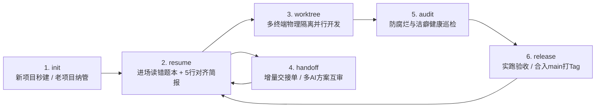

# `dev-setup` — AI 原生项目工程化基座与多 Agent 协同协议 Skill

> **一次接入，告别每次开新项目都要向 AI 重复叮嘱几千字工程规矩的繁琐日常。**
> 无论使用 **Antigravity、Claude Code、OpenAI Codex、Cursor、Gemini CLI、Windsurf、Trae** 还是其他任何 AI 编程终端，调用 `dev-setup` 即可一键完成**目录标准化、全生命周期文档构建、Git 双主干配置、断点续开发、多终端并发防踩踏与阶段验收发版**。

---

## 目录

- [1. 为什么构建 `dev-setup`？](#1-为什么构建-dev-setup)
- [2. 核心设计哲学与工作流全景](#2-核心设计哲学与工作流全景)
- [3. 受管项目的统一标准目录拓扑与命名溯源体系](#3-受管项目的统一标准目录拓扑与命名溯源体系)
- [4. 全平台 / 全 AI 客户端安装指南](#4-全平台--全-ai-客户端安装指南)
  - [4.0 前置准备：GitHub 私有仓库鉴权](#40-前置准备github-私有仓库鉴权)
  - [4.1 懒人首选：一句话让任意 AI 自动安装](#41-懒人首选一句话让任意-ai-自动安装)
  - [4.2 各主流 AI 客户端分步安装指南](#42-各主流-ai-客户端分步安装指南)
  - [4.3 多客户端玩家推荐：一次克隆 + 软链接全家桶同步](#43-多客户端玩家推荐一次克隆--软链接全家桶同步)
  - [4.4 后续版本更新方法](#44-后续版本更新方法)
- [5. 六大生命周期模式使用手册（口令速查）](#5-六大生命周期模式使用手册口令速查)
- [6. 内置五大不可逾越工程红线与三重安全门禁](#6-内置五大不可逾越工程红线与三重安全门禁)
- [7. 本仓库自身结构与自定义扩展指南](#7-本仓库自身结构与自定义扩展指南)

---

## 1. 为什么构建 `dev-setup`？

在高频使用多款 AI 工具进行项目开发时，每次启动新项目往往面临大量重复且易出错的事务性工作：

- **重复口述成本极高**：每次都要重新交代怎么写 `README.md`、怎么写 `AGENTS.md`、怎么管分支、怎么存需求/架构/迭代/验收文档。
- **跨窗口 / 跨模型“失忆乱改”**：上下文快满或换另一个 AI 接手时，缺少标准化的断点面板与交接单，新 AI 经常推翻前人设计或重复踩进同一个环境死胡同。
- **多终端并发“互相踩踏”**：同时开两个终端跑不同 AI，一旦某一方切换分支或同时修改共享状态文件，就会引发工作区代码污染或剧烈合并冲突。
- **文档迅速腐烂 & 根目录变垃圾场**：代码改了文档不改，或者 AI 随手在项目根目录丢满一次性调试脚本与临时 `.md` 文件。

`dev-setup` 将上述所有工程实践沉淀为一个标准化 **Agent Skill**，让任何 AI 在任何终端下都能以资深工程架构师的标准自动把地基打牢。

---

## 2. 核心设计哲学与工作流全景

### 2.1 「双层跨 AI 架构」：不仅安装通用，项目本身也能“自洽自治”

1. **第一层（开局基建层 — 本 Skill）**：遵循开放通用的 `SKILL.md` 规范，内置 Windows PowerShell 与 macOS/Linux POSIX Shell 双平台零依赖脚手架脚本。**1 秒钟零误差生成标准目录树、全套模板与 Git 双主干**，AI 只需向你提问 3~5 个关键问题，把 Token 全部花在撰写高质量业务需求、架构与首轮计划上。
2. **第二层（持续运行层 — 项目内 `AGENTS.md`）**：初始化完成后，项目内自动落地唯一规则事实源 `AGENTS.md`，并生成 `CLAUDE.md`、`GEMINI.md`、`.cursor/rules/00-project-os.mdc` 极简桥接指针。**哪怕后续接手的某台机器或某个客户端根本没装本 Skill，只要打开项目目录，任何 AI 都会被自动纳入同一套分支、文档与交接纪律中！**

### 2.2 全生命周期闭环图



---

## 3. 受管项目的统一标准目录拓扑与命名溯源体系

### 3.1 标准工程与文档拓扑
无论项目体量大小、采用何种语言框架，`dev-setup` 统一构建以下**肌肉记忆级标准工程外壳**（注：`init` 阶段绝不预建空的 `src/` 业务目录，避免阻塞后续 `create-next-app`、`uv init`、`pnpm create` 等框架脚手架；待代码框架初始化后再自动回填目录树）：

```text
<your-project>/
├── AGENTS.md                        # 【唯一主宪法】所有 AI 的最高行为准则、标准命令与协同总纲
├── CLAUDE.md                        # 【桥接指针】通过 @AGENTS.md 强制引导 Claude Code 对齐主宪法
├── GEMINI.md                        # 【桥接指针】强制引导 Gemini CLI / Antigravity 对齐主宪法
├── .cursor/rules/00-project-os.mdc  # 【IDE 桥接】Cursor 常驻自动加载规则（alwaysApply: true）
├── README.md                        # 【面向人类】项目定位、技术栈、快速启动命令与文档总入口
├── CHANGELOG.md                     # 【版本演进】遵循 Keep a Changelog 与 SemVer 的发版历史
├── .env.example                     # 【安全防呆】环境变量键名模板（配合 .gitignore 严防秘钥泄露）
├── .gitignore                       # 【版本防护】默认忽略秘钥、本地库快照、.tmp/* 与 .worktrees/
├── .tmp/                            # 【临时草稿隔离区】AI 一次性测试脚本与草稿唯一存放处（Git 忽略内容）
└── docs/                            # 【全项目正式文档与 AI 协同唯一中心】
    ├── 00-index.md                  # 文档总导航 + 单一事实源（SSOT）与代码变更联动表
    ├── 00-ai-hub/                   # AI 运行时控制中枢（排最前，打开 docs 第一眼可见）
    │   ├── STATE.md                 # 全局断点状态面板（当前阶段、已验收禁改区、进行中、阻塞项、下一步）
    │   ├── SESSIONS.md              # 多终端 / 多 AI 活跃会话登记与模块锁表
    │   ├── handoffs/                # 交接单：YYYY-MM-DD-HHmm-<交出AI>-to-<接收AI>-<中文主题>.md
    │   └── reviews/                 # 方案与审查：YYYY-MM-DD-<PROPOSAL|REVIEW>-<中文主题>-by-<AI>.md
    ├── 01-prd/                      # 需求中心：PRD-000-全局产品需求总纲.md + PRD-00X-<中文主题>.md
    ├── 02-architecture/             # 架构中心：ARCH-000-系统架构与模块设计总纲.md + adr/ADR-000X-<中文主题>.md
    ├── 03-contracts/                # 并行契约：API-000-全局接口契约总表.md + DATA-000-核心数据模型与字典.md
    ├── 04-iterations/               # 迭代计划：ITER-01-v0.1.0-MVP首轮迭代计划.md（序号递增）
    ├── 05-acceptance/               # 测试验收：ACCEPT-01-v0.1.0-MVP首轮验收单.md（与 ITER-XX 1:1 咬合）
    ├── 06-ops-and-pitfalls/         # 运维与错题：OPS-000-环境搭建与部署运维手册.md + PITFALLS-000-项目踩坑错题本.md
    └── 99-archive/                  # 历史封存区：存放状态改为 SUPERSEDED / DEPRECATED 的淘汰历史文档
```

### 3.2 五维文件命名、信息标签与多 AI 变更溯源规范
为防止多轮迭代后各 AI 乱起名、职责不清、无法追溯谁改了文档，`dev-setup` 对所有文件强制执行（并由 `audit` 自动巡检校验）：
1. **目录与后缀铁律**：所有文件夹强制全小写英文 `kebab-case`；全仓严禁出现 `_v2`、`_new`、`_final`、`_old`、`_bak`、`副本`、`最终版` 等无序后缀。
2. **常青 `000` 主文档 vs 阶段编号文档**：`-000-` 结尾的主文档全周期仅此一份原地更新；阶段文档严格按 `PRD-00X-中文主题.md`、`ITER-XX-vX.Y.Z-中文主题.md` ↔ `ACCEPT-XX-vX.Y.Z-中文主题.md` 1:1 对齐命名。
3. **顶部直观「中文文档元信息卡」**：每篇正式文档标题下方强制展示**文档编号、当前状态、关联版本、创建角色与时间、最后修改角色与时间**。
4. **受控信息标签词典**：文档状态仅限 `DRAFT` | `ACTIVE` | `COMPLETED` | `SUPERSEDED` | `DEPRECATED`；优先级仅限 `P0`~`P3`；任务与验证状态仅限 `TODO` | `IN_PROGRESS` | `BLOCKED` | `MOCK_TEMP` | `PASS` | `FAIL`。作废旧文档统一移入 `docs/99-archive/`。
5. **文末强制「文档变更记录表」**：任何 AI 或人类每次修改文档正文，必须同步递增版本号并在文末表格记录**修订时间、操作角色（如 `Claude-Code` / `Codex` / `Antigravity`）、关联分支及修改原因**。

---

## 4. 全平台 / 全 AI 客户端安装指南

> 以下示例请将仓库地址替换为你自己的私有仓库地址（例如 `https://github.com/ligoo13/dev-setup.git` 或 `git@github.com:ligoo13/dev-setup.git`）。

### 4.0 前置准备：GitHub 私有仓库鉴权

由于本仓库为 **Private（私有仓库）**，在新电脑或新服务器上首次拉取前，请确保已完成以下任一 GitHub 身份认证：

- **方式 A（推荐 · GitHub CLI）**：运行 `gh auth login` 按提示完成浏览器一键登录，随后执行 `gh auth setup-git`。
- **方式 B（SSH 密钥）**：本机已配置 `~/.ssh/id_ed25519` 并将公钥添加至 GitHub Settings → SSH keys，使用 `git@github.com:ligoo13/dev-setup.git` 地址克隆。
- **方式 C（Windows / macOS HTTPS 凭据管理器）**：直接运行下方 `git clone https://...` 命令，在弹出的系统 GitHub 登录窗口授权即可自动缓存凭据。

---

### 4.1 懒人首选：一句话让任意 AI 自动安装

在任何具备终端执行权限的 AI 工具（Antigravity、Claude Code、Codex、Cursor、Gemini CLI 等）中，直接发送以下指令，让 AI 自己完成克隆与挂载：

```text
请帮我把我的 GitHub 私有仓库 https://github.com/ligoo13/dev-setup.git 克隆安装为你当前客户端的全局 dev-setup Skill（目标文件夹名必须为 dev-setup），安装完成后告诉我校验结果。
```

---

### 4.2 各主流 AI 客户端分步安装指南

#### ① Google Antigravity

- **全局安装（推荐，本机所有工作区自动可用）**：
  - **Windows (PowerShell)**：
    ```powershell
    New-Item -ItemType Directory -Force "$HOME\.gemini\config\skills" | Out-Null
    git clone https://github.com/ligoo13/dev-setup.git "$HOME\.gemini\config\skills\dev-setup"
    ```
  - **macOS / Linux (Bash/Zsh)**：
    ```bash
    mkdir -p ~/.gemini/config/skills
    git clone https://github.com/ligoo13/dev-setup.git ~/.gemini/config/skills/dev-setup
    ```
- **单项目安装**：克隆至 `<项目根目录>/.agents/skills/dev-setup`。

---

#### ② Claude Code（CLI 终端 & VS Code / JetBrains 插件通用）

安装后不仅能根据自然语言自动激活，还可直接在对话框输入 `/dev-setup` 斜杠命令调用！

- **全局安装（推荐，本机所有项目可用）**：
  - **Windows (PowerShell)**：
    ```powershell
    New-Item -ItemType Directory -Force "$HOME\.claude\skills" | Out-Null
    git clone https://github.com/ligoo13/dev-setup.git "$HOME\.claude\skills\dev-setup"
    ```
  - **macOS / Linux (Bash/Zsh)**：
    ```bash
    mkdir -p ~/.claude/skills
    git clone https://github.com/ligoo13/dev-setup.git ~/.claude/skills/dev-setup
    ```
- **单项目安装**：克隆至 `<项目根目录>/.claude/skills/dev-setup`。

---

#### ③ OpenAI Codex（Codex CLI & 桌面端 / IDE 扩展）

- **全局安装（推荐）**：
  - **Windows (PowerShell)**：
    ```powershell
    New-Item -ItemType Directory -Force "$HOME\.codex\skills" | Out-Null
    git clone https://github.com/ligoo13/dev-setup.git "$HOME\.codex\skills\dev-setup"
    ```
  - **macOS / Linux (Bash/Zsh)**：
    ```bash
    mkdir -p ~/.codex/skills
    git clone https://github.com/ligoo13/dev-setup.git ~/.codex/skills/dev-setup
    ```
  *(注：新版跨代理通用目录 `~/.agents/skills/dev-setup` 同样受 Codex 支持。)*
- **单项目安装**：克隆至 `<项目根目录>/.agents/skills/dev-setup`。

---

#### ④ Gemini CLI

- **全局安装**：
  - **Windows (PowerShell)**：
    ```powershell
    New-Item -ItemType Directory -Force "$HOME\.gemini\skills" | Out-Null
    git clone https://github.com/ligoo13/dev-setup.git "$HOME\.gemini\skills\dev-setup"
    ```
  - **macOS / Linux (Bash/Zsh)**：
    ```bash
    mkdir -p ~/.gemini/skills
    git clone https://github.com/ligoo13/dev-setup.git ~/.gemini/skills/dev-setup
    ```
- **单项目安装**：克隆至 `<项目根目录>/.gemini/skills/dev-setup` 或 `<项目根目录>/.agents/skills/dev-setup`。

---

#### ⑤ Cursor（AI IDE）

- **全局安装（Cursor Settings → Rules / Skills 全局目录）**：
  - **Windows (PowerShell)**：
    ```powershell
    New-Item -ItemType Directory -Force "$HOME\.cursor\skills" | Out-Null
    git clone https://github.com/ligoo13/dev-setup.git "$HOME\.cursor\skills\dev-setup"
    ```
  - **macOS / Linux (Bash/Zsh)**：
    ```bash
    mkdir -p ~/.cursor/skills
    git clone https://github.com/ligoo13/dev-setup.git ~/.cursor/skills/dev-setup
    ```
- **单项目安装**：克隆至 `<项目根目录>/.cursor/skills/dev-setup`。

---

#### ⑥ Windsurf / Trae / Cline / Roo Code / GitHub Copilot / 其他任意客户端

- **若客户端已支持通用 Agent Skills（`.agents/skills`）**：
  直接克隆至全局 `~/.agents/skills/dev-setup` 或项目内 `.agents/skills/dev-setup`。
- **通用零插件兜底用法（兼容任何能读本地文件的 AI 工具）**：
  1. 将本仓库克隆到本机固定目录，例如 `~/ai-skills/dev-setup`（Windows 如 `D:\ai-skills\dev-setup`）；
  2. 开启新项目时，在对话框中输入：
     `请读取 ~/ai-skills/dev-setup/SKILL.md，按其中的 init 模式帮我初始化当前项目。`
  3. 初始化一旦完成，项目根目录生成的 `AGENTS.md` 与桥接文件将自动常驻生效，后续任何客户端打开该项目都无需再次引用 Skill 路径！

---

### 4.3 多客户端玩家推荐：一次克隆 + 软链接全家桶同步

如果你在同一台电脑上同时使用 Antigravity、Claude Code、Codex、Cursor、Gemini CLI，推荐**只克隆一份母本仓库**，然后用系统软链接（Windows Directory Junction / Unix Symlink）挂载到所有客户端。这样日后只需 `git pull` 一次，全部 AI 客户端瞬间同步最新规范！

#### Windows 一键全家桶挂载（PowerShell，无需管理员权限）
```powershell
$RepoUrl = "https://github.com/ligoo13/dev-setup.git"
$MasterDir = "$HOME\.ai-skills\dev-setup"

New-Item -ItemType Directory -Force "$HOME\.ai-skills" | Out-Null
git clone $RepoUrl $MasterDir

$Targets = @(
    "$HOME\.gemini\config\skills\dev-setup",
    "$HOME\.gemini\skills\dev-setup",
    "$HOME\.claude\skills\dev-setup",
    "$HOME\.codex\skills\dev-setup",
    "$HOME\.agents\skills\dev-setup",
    "$HOME\.cursor\skills\dev-setup"
)

foreach ($dst in $Targets) {
    $parent = Split-Path -Parent $dst
    New-Item -ItemType Directory -Force $parent | Out-Null
    if (-not (Test-Path -LiteralPath $dst)) {
        New-Item -ItemType Junction -Path $dst -Target $MasterDir | Out-Null
        Write-Host "[LINKED] $dst -> $MasterDir"
    }
}
```

#### macOS / Linux 一键全家桶挂载（Bash / Zsh）
```bash
REPO_URL="https://github.com/ligoo13/dev-setup.git"
MASTER_DIR="$HOME/.ai-skills/dev-setup"

mkdir -p "$HOME/.ai-skills"
git clone "$REPO_URL" "$MASTER_DIR"

for dst in \
  "$HOME/.gemini/config/skills/dev-setup" \
  "$HOME/.gemini/skills/dev-setup" \
  "$HOME/.claude/skills/dev-setup" \
  "$HOME/.codex/skills/dev-setup" \
  "$HOME/.agents/skills/dev-setup" \
  "$HOME/.cursor/skills/dev-setup"
do
  mkdir -p "$(dirname "$dst")"
  [ -e "$dst" ] || ln -s "$MASTER_DIR" "$dst"
  echo "[LINKED] $dst -> $MASTER_DIR"
done
```

---

### 4.4 后续版本更新方法

当你在 GitHub 上迭代更新了本仓库的规范或模板后，在任意终端只需执行一行命令即可拉取最新规则：

```bash
# 若采用 4.3 软链接全家桶方案：
git -C ~/.ai-skills/dev-setup pull

# 若采用单客户端独立克隆（以 Claude Code 为例）：
git -C ~/.claude/skills/dev-setup pull
```

---

## 5. 六大生命周期模式使用手册（口令速查）

安装完成后，在任意项目中直接对 AI 说自然语言（或在支持斜杠指令的客户端输入 `/dev-setup`）即可触发对应流程：

| 模式 | 何时使用 | 推荐直接发送给 AI 的口令示例 | AI 自动完成的工程动作 |
| :--- | :--- | :--- | :--- |
| **`init`**<br/>新项目基建 | 刚建好空文件夹准备开新项目 | `用 dev-setup 初始化这个新项目` | 1. 简短询问 3~5 个核心问题（定位、技术栈、MVP 范围）<br/>2. 调用脚本 1 秒生成全套目录、跨工具桥接与文档外壳<br/>3. 将你的回答实质性填充进 PRD、架构、ADR 与首轮计划<br/>4. 初始化 Git `main` 基线提交并自动切入 `develop` 分支 |
| **`init`**<br/>老项目纳管 | 半路接手已有代码仓或散乱项目 | `用 dev-setup 把当前存量项目无损纳入标准规范` | 1. 绝不覆盖已有 `README.md` 与历史 Git 提交<br/>2. 无损增量合并 `.gitignore`，补齐 `docs/00`~`06` 结构<br/>3. 扫描现有代码逆向梳理架构与当前 `STATE.md` 进度<br/>4. 安全建立 `main` + `develop` 双主干 |
| **`resume`**<br/>断点续开发 | 新开终端窗口或换另一个 AI 接手 | `按 dev-setup resume 对齐进度，我们继续开发` | 1. 依次读取 `AGENTS.md` → `STATE.md` → `SESSIONS.md` → 最新交接单 → `pitfalls.md`（错题本）<br/>2. 改代码前先向你输出 **≤5 行「进度对齐简报」**<br/>3. 登记 `SESSIONS.md` 模块锁后精准开工 |
| **`handoff`**<br/>交接与互审 | 准备下班、上下文快满、换 AI 接力或多 AI 方案比选 | `今天先到这，按 dev-setup handoff 写交接单准备换 Codex 接手`<br/>或 `按 dev-setup 对当前分支做一次交叉 Code Review` | 1. 将临时测试脚本清理至 `.tmp/`，把新踩的坑写入 `pitfalls.md`<br/>2. 在 `handoffs/` 生成独立命名交接单（或 `reviews/` 生成比选/审查报告）<br/>3. 刷新进度、释放模块锁，并给出下一窗口的一键唤醒口令 |
| **`worktree`**<br/>多端并发隔离 | 同时开第 2+ 个终端并行开发不同功能分支 | `我要开第二个终端做鉴权模块，用 dev-setup 开个 feat/auth 的并行 worktree` | 1. 主目录保持在 `develop` 不动，在 `.worktrees/feat-auth` 创建物理隔离工作区<br/>2. 避免多终端同目录切分支导致文件互相篡改<br/>3. 开发合并完成后支持一键安全验证回收工作区与临时分支 |
| **`release`**<br/>验收与发版 | 完成一轮迭代，准备归档发布新版本 | `当前迭代写完了，按 dev-setup release 执行验收并发布 v0.1.0` | 1. 先跑健康巡检确认无假数据 Mock 残留、无秘钥泄露<br/>2. 逐项**在终端实跑** `05-acceptance` 中的测试/构建验证命令<br/>3. 更新 `CHANGELOG.md`，`--no-ff` 合入 `main` 并打 `v0.1.0` Tag，再切回 `develop` |
| **`audit`**<br/>防腐烂巡检 | 多 AI 高频开发一段时间后做体检 | `跑一次 dev-setup audit 检查项目规范和文档同步情况` | 自动扫描根目录遗留垃圾、`.env` 追踪风险、僵尸会话锁，并比对代码与架构/接口契约是否脱节，输出分级修复报告 |

---

## 6. 内置五大不可逾越工程红线与三重安全门禁

每一个由 `dev-setup` 初始化的项目，都会通过 **「AI 宪法红线 + 物理级 Git Hooks 拦截」** 双重机制强制守护工程质量与数据安全：

### 6.1 五大最高优先级工程红线
1. **反糊弄铁律**：严禁未经明确允许使用硬编码假数据（Mock / Stub / 空壳 `TODO`）冒充功能已完成；未在终端实跑通过验证命令前，严禁汇报“已完成”。
2. **防越界与洁癖铁律**：严守最小改动半径，禁止顺手重构无关文件、禁止擅自新增重型依赖、禁止触碰其他 AI 锁定的模块；所有临时验证脚本一律进 `.tmp/`，严禁污染项目根目录。
3. **进场先对齐铁律**：新会话动笔写代码前，必读 `STATE.md` 与 `pitfalls.md`（错题本），并先输出 ≤5 行「进度对齐简报」。
4. **数据安全与脱敏推送铁律**：严禁硬编码 API Key、云厂商 AK/SK、私钥、明文密码连接串或 Webhook；文档、交接单与错题本强制剥离真实服务器 IP、鉴权报文与用户隐私数据（PII）。**通过自动化敏感扫描后允许 AI 自主执行 `git commit` 与 `git push`，但严禁使用 `--no-verify` 绕过安全钩子！**
5. **高危操作熔断铁律**：凡涉及删除核心文件/数据、推翻既有 ADR 架构决策、`git reset --hard`、`git push --force` 或直接在 `main` 提交，必须立即停机请示人类确认。

### 6.2 自动部署的三重敏感信息拦截防线（Secret Guard）
- **第一重（`.gitignore` 黑名单底座）**：默认屏蔽 `.env*`、私钥证书（`*.pem`/`*.key`/`*.p12`/`id_rsa`）、云服务凭据（`*credentials*.json`/`*service-account*.json`/`.npmrc`）、本地数据库快照（`*.sqlite`/`*.db`/`*.dump`）以及含 Cookie 登录态的浏览器抓包（`*.har`）。
- **第二重（`.git/hooks/pre-commit` & `pre-push` 本地物理熔断钩子）**：执行 `git-setup` 时自动装入仓库。一旦暂存区或待推送记录中出现主流大模型/平台 Key（`sk-...`、`AIza...`、`ghp_...`）、阿里云/腾讯云/AWS 凭据（`LTAI...`、`AKID...`、`AKIA...`）、私钥块、带明文密码的数据库连接串或未脱敏的 `Authorization: Bearer` 报文，**Git 底层直接报错中止提交与推送**，防止秘钥污染 Git 历史。
- **第三重（全仓主动扫描 `secret-scan`）**：随时支持调用 `bootstrap.ps1 -Action secret-scan`（或 `bootstrap.sh --action secret-scan`）及 `audit` 对全仓已追踪与未忽略文件做全量安全体检。

---

## 7. 本仓库自身结构与自定义扩展指南

```text
dev-setup/
├── SKILL.md                                  # Skill 核心定义与 6 大模式路由总控
├── README.md                                 # 本说明文档（含全平台安装与使用手册）
├── scripts/
│   ├── bootstrap.ps1                         # Windows 原生零依赖脚手架与巡检引擎（UTF-8 无 BOM）
│   └── bootstrap.sh                          # macOS / Linux / POSIX 零依赖脚手架与巡检引擎
├── references/                               # 按需加载的细分模式操作手册（Progressive Disclosure）
│   ├── standards-naming-and-metadata.md      # 全局文件命名、受控标签词典与文档修订溯源规范
│   ├── mode-init-and-brownfield.md
│   ├── mode-resume-and-handoff.md
│   ├── mode-git-worktree-and-release.md
│   └── mode-audit-and-doc-ssot.md
└── templates/                                # 目标项目渲染模板库（标准模板 + 安全钩子）
    ├── hooks/                                # 自包含 pre-commit / pre-push 秘钥物理拦截钩子
    ├── root/                                 # AGENTS.md、CLAUDE.md、GEMINI.md、Cursor 规则、README 等
    └── docs/                                 # 00-index.md 与 00-ai-hub ~ 06-ops-and-pitfalls 模板
```

### 如何按个人偏好继续演进？
- **增改全局开发红线**：编辑 `templates/root/AGENTS.md.tmpl` 并在 `SKILL.md` 第 3 节同步，提交推送后各终端 `git pull` 即可全局生效。
- **定制文档章节结构**：直接修改 `templates/docs/` 下对应的 `.tmpl` 文件（支持 `{{PROJECT_NAME}}`、`{{PROJECT_SUMMARY}}`、`{{TECH_STACK}}`、`{{DATE}}`、`{{DATETIME}}` 五个自动渲染占位符）。
